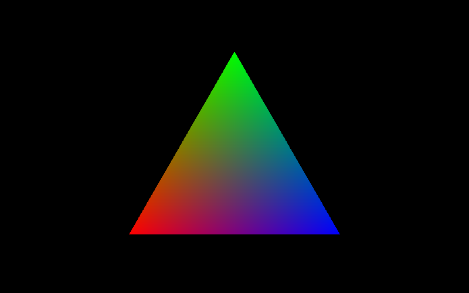
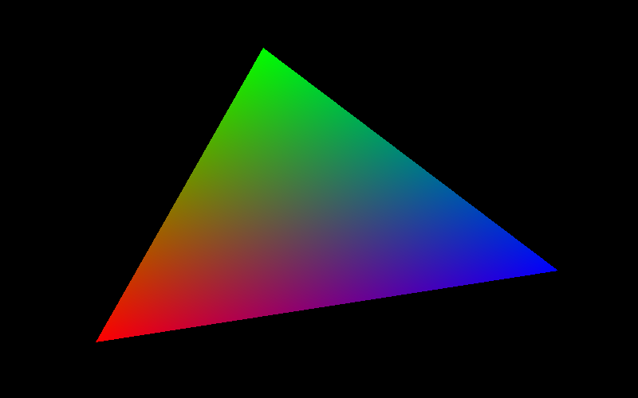
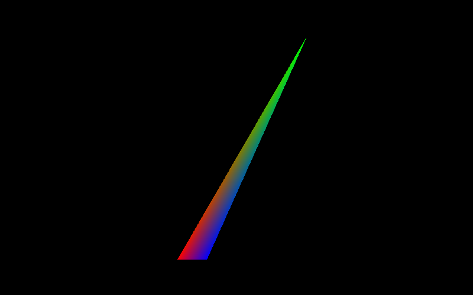

# Laboratorio 3: Triángulo baricéntrico

Gráficas por computadora, UVG. Hecho en Zig 0.16.0.

Se dibuja un triángulo cuyo color se interpola con **coordenadas baricéntricas**: cada punto interior mezcla rojo, verde y azul según qué tan cerca está de cada vértice. Funciona con cualquier triángulo.

## Cómo funciona

1. **Framebuffer:** una imagen en memoria donde se escribe píxel por píxel (`src/framebuffer.zig`).
2. **Vectores:** resta, producto cruz y producto punto (`src/vec3.zig`).
3. **Coordenadas baricéntricas:** para un punto P y un triángulo (v0, v1, v2), el peso de cada vértice es el área del sub-triángulo opuesto dividida entre el área total. Se calcula con el producto cruz, siguiendo el método de Scratchapixel:
   - `N = (v1 - v0) × (v2 - v0)`
   - para cada arista, `C = arista × (P - vértice)`
   - peso = `N·C / N·N`
4. **Pintado:** se recorre la caja contenedora del triángulo y, en el centro de cada píxel, se calculan los pesos `w0, w1, w2`.
   - Si alguno es negativo, el píxel está fuera y se deja negro.
   - Si no, el color es `w0·rojo + w1·verde + w2·azul`.

Como el signo de `N` y de `C` cambia junto al invertir el orden de los vértices, el resultado no depende de cómo se ordenen.

## Resultados

| Casi equilátero | Irregular | Delgado |
|---|---|---|
|  |  |  |

Vértices (en píxeles, v0 rojo, v1 verde, v2 azul):

| Triángulo | v0 | v1 | v2 |
|---|---|---|---|
| 1 | (220, 400) | (400, 88) | (580, 400) |
| 2 | (120, 430) | (330, 60) | (700, 340) |
| 3 | (300, 440) | (520, 60) | (350, 440) |

## Cómo correrlo

```
zig build run -Doptimize=ReleaseFast
```

La barra espaciadora cambia entre los 3 triángulos. Al iniciar se exportan `triangulo1.png`, `triangulo2.png` y `triangulo3.png`.
